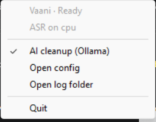

# Vaani

**Fully local push-to-talk dictation for Windows.** Hold a key, speak, release, and clean text appears in whatever app you're typing in. No cloud, no account, no word limits.

- **ASR:** NVIDIA Parakeet TDT 0.6B v3 on your GPU (CUDA), with Silero VAD so silence never turns into text
- **Cleanup (optional):** a small local LLM via Ollama fixes punctuation, removes "um"s and handles self-corrections
- **Custom vocabulary + voice snippets** in `config.toml`
- Tray icon: 🟦 loading · 🟩 ready · 🟥 listening · 🟨 transcribing

## Requirements

- Windows 10/11
- NVIDIA GPU with a recent driver (R580 or newer, for CUDA 13). Works on CPU too, just slower.
- [Python 3.12](https://www.python.org/downloads/) (tick "Add to PATH" / install the `py` launcher)
- [Ollama](https://ollama.com) (optional, for AI cleanup)

## Setup

```powershell
cd path\to\vaani
powershell -ExecutionPolicy Bypass -File setup.ps1
```

This creates `.venv`, installs dependencies (~1 GB because of the CUDA libraries), downloads the Parakeet and Silero models, and pulls `gemma3:4b` in Ollama if it's installed.

## Use

Double-click `run.bat`. Vaani runs in the system tray (click `^` on the taskbar if the icon is hidden). When
it is ready, click into any text box, then **hold Caps Lock (the default hotkey), speak, release.**



- The tray menu shows the status and which device the speech model runs on, toggles AI cleanup, and opens
  the config and log folder.
- Short dictations (under 8 words) skip the LLM and paste almost instantly.
- With `streaming = true`, long dictations paste phrase by phrase when you pause while holding the key.
- Wrong or silent microphone ("no speech detected" in the log)? Windows may be using a virtual or disabled
  input. Set `input_device` under `[audio]` in `config.toml` to part of your mic's name.
- Debug with `run-debug.bat`; logs live in `%LOCALAPPDATA%\Vaani\vaani.log`.
- Start with Windows: press `Win+R`, type `shell:startup`, and put a shortcut to `run.bat` there.
- Benchmark: `.venv\Scripts\python -m vaani --file some.wav`

## Configure

Edit `config.toml` (tray → Open config), then restart. Highlights:

| Setting | What it does |
|---|---|
| `[hotkey] key / mode` | Push-to-talk key, or toggle mode with combos |
| `[audio] keep_mic_open` | Zero start delay + pre-roll so your first word is never clipped (mic indicator stays on) |
| `[cleanup] llm_model` | Any Ollama model; small 1–4B instruct models are the sweet spot for an 8 GB GPU |
| `[replacements]` | "pie torch" → "PyTorch" style fixes |
| `[snippets]` | Say "insert my signature" to paste a block of text |

## Benchmarks

<!-- bench:start -->
Parakeet TDT 0.6B v3 fp32 on NVIDIA GeForce RTX 4050 Laptop GPU (6 GB), driver 591.66, AMD Ryzen 7 7435HS; shipped pipeline (Silero VAD, no cleanup), 914 clips in this run, 200 per public set (seed 0). WER is corpus-level on Open ASR Leaderboard-normalized text with a 95% bootstrap CI. Latency is `Pipeline.process` per clip (no paste). From a clean commit (`ace27dd`): [`20261025T044644Z_ace27dd_release-gpu.json`](evals/results/20261025T044644Z_ace27dd_release-gpu.json).

| Set | Clips | WER % [95% CI] | Latency ms p50 / p95 | ASR RTFx |
|---|---:|---|---|---:|
| FLEURS en_us | 200 | 6.36 [5.1–7.7] | 289 / 406 | 34.4 |
| LibriSpeech test-clean | 200 | 2.04 [1.5–2.6] | 135 / 251 | 48.0 |
| LibriSpeech test-other | 200 | 3.79 [2.9–4.8] | 134 / 223 | 44.1 |
| Svarah (Indian-accented English) | 200 | 10.14 [7.7–12.5] | 232 / 383 | 20.7 |
| **All four** | 800 | 5.06 [4.4–5.7] | 181 / 370 | 34.5 |

Harness check: the same model without VAD on the full LibriSpeech test-clean (2620 clips) gives 1.89% WER [1.74–2.05], against 1.93% published on the model card (inside our CI: yes). Result: [`20261024T100052Z_255cdb2_validate-novad.json`](evals/results/20261024T100052Z_255cdb2_validate-novad.json).
<!-- bench:end -->

Reproduce (needs the eval dependencies, a free Hugging Face login for the gated Svarah set, ~3 GB of disk):

```powershell
.\.venv\Scripts\python -m pip install -r requirements-eval.txt ; .\.venv\Scripts\python -m evals.datasets.prepare ; .\.venv\Scripts\python -m evals.run_eval --device cuda --cleanup off --label repro
```

The README table is generated from the committed result file (`python -m evals.bench_table --check` runs in
the tests), and only runs from a clean commit are quoted. The Phase 3-5 results (silence/noise, injection safety, CPU vs GPU vs Whisper, cleanup models, end-to-end
release-to-paste latency, 1000-dictation soak) are in [`evals/results/`](evals/results); the ones taken on a
dirty tree are marked as such in their reports and are not quoted here. Method, datasets and gates:
[evals/README.md](evals/README.md).

## Privacy

Audio and text never leave your machine. The only network call is to Ollama on `127.0.0.1`, and
`llm_url` is rejected at startup if it points anywhere else. The test suite blocks every non-loopback
socket and checks the pipeline still works (`tests/test_privacy.py`), and CI repeats that with the real
models (`--block-network`). Models are downloaded once, during setup. See [SECURITY.md](SECURITY.md).

## Limitations

- **Languages:** Parakeet v3 covers English and 24 European languages. No Malayalam or Hindi.
- **Accuracy is model-bound:** the table above is read speech. Accented English is measurably harder
  (Svarah), and your microphone, room and speaking style will differ. The only dictation-style test set
  is one speaker on one laptop microphone, so treat it as a smoke test, not a benchmark.
- **Cleanup can be wrong:** a small local LLM sometimes rewrites more than asked or tries to answer a
  dictated question instead of cleaning it. Vaani falls back to the raw transcript when its output looks
  implausible, but cleanup is optional for a reason; compare models with the eval suite.
- **Latency is measured on one machine** (RTX 4050 Laptop, 6 GB). CPU-only is slower; the GPU shares
  VRAM with the cleanup model, so `device = "auto"` runs ASR on the CPU when cleanup is on.
- **Windows only**, and the Fn key is invisible to Windows on most laptops. Pasting into
  Administrator windows needs Vaani to run as Administrator. Only text on the clipboard is restored.
- CI cannot test the GPU or the real keyboard/microphone path; those run locally before a release.

## Notes

- Parakeet v3 handles English and 24 European languages. It does not support Malayalam or Hindi yet.
- Pasting into apps running as Administrator requires running Vaani as Administrator too.
- The clipboard is restored after pasting, but only if it held text.

MIT License. Third-party models, libraries and datasets: see [NOTICE](NOTICE). Contributing: [CONTRIBUTING.md](CONTRIBUTING.md).
